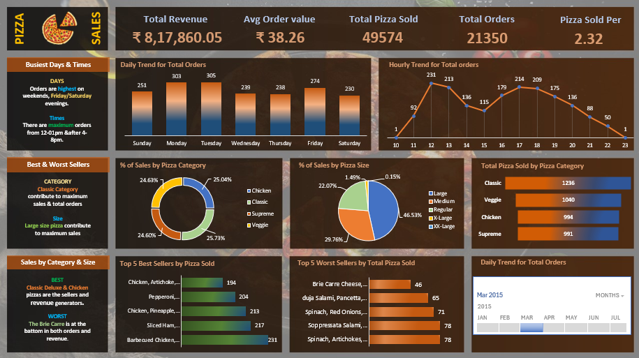

# 🍕 Pizza Sales Performance Analysis | SQL (PostgreSQL) + Excel Dashboard

> End-to-end sales analysis of **48,620 pizza line items / 21,350 orders (Jan–Dec 2015)**: data cleaning and validation in Excel, KPI and trend queries in PostgreSQL, and an interactive Excel dashboard with a date timeline filter.

**Tools:** PostgreSQL · SQL · Microsoft Excel (cleaning, Tables, PivotTables, Timeline filter, Charts)

---

## 📌 Table of Contents
1. [Project Overview](#-project-overview)
2. [Dataset Used](#-dataset-used)
3. [Questions (KPIs & Analysis)](#-questions-kpis--analysis)
4. [Dashboard Interaction](#-dashboard-interaction)
5. [Process](#-process)
6. [Project Insights](#-project-insights)
7. [Conclusion](#-conclusion)
8. [Repository Structure](#-repository-structure)
9. [How to Run](#-how-to-run)

---

## 📖 Project Overview

A pizza restaurant records every pizza sold, but the raw rows alone do not show **when customers order, which pizzas drive revenue, or which items should be reconsidered**. This project turns the 2015 transaction data into answers for owners and managers:

- **How is the business performing?** Revenue, orders, pizzas sold, average order value and pizzas per order.
- **When is it busiest?** Orders by day of the week, by hour, and by month.
- **What sells?** Revenue and units by category and size, plus the best and worst selling pizzas.

SQL is used for the calculations, and Excel is used for cleaning and for the interactive dashboard, so every KPI on the dashboard can be reproduced with a query.

---

## 📂 Dataset Used

| File | Description |
|---|---|
| [`data/pizza_sales.csv`](data/pizza_sales.csv) | Raw dataset: 48,620 rows × 12 columns (one row per pizza line item) |
| [`dashboard/pizza_sales_excel_dashboard.xlsx`](dashboard/pizza_sales_excel_dashboard.xlsx) | Excel workbook with raw data, cleaned data, KPIs, trends and dashboard |
| [`sql/pizza_sales_analysis_queries_postgresql.sql`](sql/pizza_sales_analysis_queries_postgresql.sql) | Table creation, data load and all analysis queries |

Source: Pizza Place Sales public dataset ([Maven Analytics Data Playground](https://www.mavenanalytics.io/data-playground)).

**Columns:** `pizza_id`, `order_id`, `pizza_name_id`, `quantity`, `order_date`, `order_time`, `unit_price`, `total_price`, `pizza_size`, `pizza_category`, `pizza_ingredients`, `pizza_name`

**Coverage:** 1 Jan 2015 – 31 Dec 2015 · 32 pizzas · 4 categories (Classic, Supreme, Veggie, Chicken) · 5 sizes (S, M, L, XL, XXL)

---

## ❓ Questions (KPIs & Analysis)

**A. KPIs**
1. What is the **Total Revenue**?
2. What is the **Average Order Value**?
3. How many **Total Pizzas** were sold?
4. How many **Total Orders** were placed?
5. What is the **Average Number of Pizzas per Order**?

**B. Charts and trends**

6. What is the **daily trend** of total orders (which weekdays are busiest)?
7. What is the **hourly trend** of orders (which hours are busiest)?
8. What **percentage of sales** comes from each **pizza category**?
9. What **percentage of sales** comes from each **pizza size**?
10. How many pizzas were sold in each **pizza category**?
11. Which are the **Top 5 best-selling pizzas** by quantity?
12. Which are the **Bottom 5 selling pizzas** by quantity?

**C. Filters and business questions**

13. How do orders by weekday change for a chosen **month**, **quarter** or **week**?
14. What were the **revenue and orders in Quarter 1** (Jan–Mar)?
15. How does **revenue move month by month**?

---

## 📊 Dashboard Interaction

👉 **[Open the interactive dashboard: `pizza_sales_excel_dashboard.xlsx`](dashboard/pizza_sales_excel_dashboard.xlsx)** and go to the **`Dashboard & Visualization`** sheet.

Download the file, open it in Microsoft Excel and use the **date timeline** at the bottom-right of the dashboard to filter every chart by month. The workbook has 5 sheets:

| Sheet | Purpose |
|---|---|
| `Raw Data Source File` | Original data, untouched |
| `Data Cleaning of source file` | Cleaned Excel Table used by all pivots |
| `KIPs` | KPI calculations |
| `Trends` | PivotTables and charts behind the dashboard |
| `Dashboard & Visualization` | Final dashboard |

---

## ⚙️ Process

### 1. Data cleaning (Excel)
- Kept an untouched copy of the raw data in its own sheet.
- Converted `order_date` from text (`DD-MM-YYYY`) to a real **Date** type and `order_time` to a **Time** type.
- Replaced size codes with readable labels (S → Regular, M → Medium, L → Large, XL → X-Large, XXL → XX-Large).
- Added helper columns: `Order_Day` (weekday name) and `Total_orders` (`1 / COUNTIF(order_id)`) so that orders can be counted correctly in PivotTables even when one order has several pizzas.
- Converted the range into an **Excel Table** so formulas and PivotTables expand automatically.

### 2. Data validation
- ✅ **0 null values** across all 12 columns
- ✅ **0 duplicate** rows and **0 duplicate `pizza_id`**
- ✅ `unit_price × quantity = total_price` holds on **all 48,620 rows**
- ✅ All dates fall inside 2015 and all dates parse correctly
- ✅ Excel PivotTable totals **match the SQL results** (revenue 817,860.05 · 21,350 orders · 49,574 pizzas)

### 3. How the project was done
1. Loaded the CSV into PostgreSQL (`pizza_sales` table, with `DateStyle = DMY` for the date format).
2. Wrote SQL for the 5 KPIs and the trend/ranking queries (`COUNT(DISTINCT order_id)` so orders are not double counted).
3. Cleaned the same data in Excel and rebuilt each KPI and chart with PivotTables.
4. Built a one-page dashboard with KPI cards, 8 charts and a date timeline.
5. Reconciled SQL and Excel numbers, then wrote the insights.

### 4. Skills used
**SQL (PostgreSQL):** `GROUP BY`, aggregate functions, `COUNT(DISTINCT)`, subquery for % of total, `EXTRACT`, `TO_CHAR`, `CAST`, `ORDER BY ... LIMIT`, date filters
**Excel:** data cleaning, Tables, PivotTables and PivotCharts, Timeline filter, GETPIVOTDATA, dashboard layout
**Analysis:** KPI definition, trend analysis, data validation, business storytelling

---

## 🔎 SQL Results (verified on PostgreSQL 16)

**KPIs**

| Total Revenue | Total Orders | Total Pizzas Sold | Avg Order Value | Avg Pizzas / Order |
|---:|---:|---:|---:|---:|
| 817,860.05 | 21,350 | 49,574 | 38.31 | 2.32 |

**Orders by day of week**

| Mon | Tue | Wed | Thu | Fri | Sat | Sun |
|---:|---:|---:|---:|---:|---:|---:|
| 2,794 | 2,973 | 3,024 | 3,239 | **3,538** | 3,158 | 2,624 |

**Orders by hour (busiest hours highlighted)**

| Hour | 9 | 10 | 11 | **12** | **13** | 14 | 15 | 16 | **17** | **18** | 19 | 20 | 21 | 22 | 23 |
|---|---:|---:|---:|---:|---:|---:|---:|---:|---:|---:|---:|---:|---:|---:|---:|
| Orders | 1 | 8 | 1,231 | **2,520** | **2,455** | 1,472 | 1,468 | 1,920 | **2,336** | **2,399** | 2,009 | 1,642 | 1,198 | 663 | 28 |

**Sales by category**

| Category | Revenue | % of Sales | Pizzas Sold |
|---|---:|---:|---:|
| Classic | 220,053.10 | 26.91% | 14,888 |
| Supreme | 208,197.00 | 25.46% | 11,987 |
| Chicken | 195,919.50 | 23.96% | 11,050 |
| Veggie | 193,690.45 | 23.68% | 11,649 |

**Sales by size**

| Size | Revenue | % of Sales |
|---|---:|---:|
| L | 375,318.70 | 45.89% |
| M | 249,382.25 | 30.49% |
| S | 178,076.50 | 21.77% |
| XL | 14,076.00 | 1.72% |
| XXL | 1,006.60 | 0.12% |

**Top 5 and Bottom 5 pizzas (by quantity)**

| Top 5 | Qty | | Bottom 5 | Qty |
|---|---:|---|---|---:|
| The Classic Deluxe Pizza | 2,453 | | The Brie Carre Pizza | 490 |
| The Barbecue Chicken Pizza | 2,432 | | The Mediterranean Pizza | 934 |
| The Hawaiian Pizza | 2,422 | | The Calabrese Pizza | 937 |
| The Pepperoni Pizza | 2,418 | | The Spinach Supreme Pizza | 950 |
| The Thai Chicken Pizza | 2,371 | | The Soppressata Pizza | 961 |

---

## 💡 Project Insights

1. **Friday is the busiest day, Sunday the quietest.** Friday has 3,538 orders (16.6% of the year) against 2,624 on Sunday. Thursday to Saturday together make up 46.5% of all orders.
2. **Two daily rushes drive the business.** Lunch (12:00–13:59) and dinner (17:00–19:59) bring 54.9% of all orders. Orders peak at 12 pm (2,520) and 6 pm (2,399), with a dip between 2 and 3 pm.
3. **Classic is the top category**, with 26.91% of revenue and the most pizzas sold (14,888). The four categories are close, from 23.68% to 26.91%, so no category is dominant.
4. **Large pizzas generate almost half of revenue** (45.89%). Large and Medium together bring 76.4%, while XL and XXL contribute only 1.84%.
5. **Chicken pizzas lead on revenue per item.** The Thai Chicken, Barbecue Chicken and California Chicken pizzas are the three highest earners, even though the Classic Deluxe sells the most units.
6. **The Brie Carre Pizza is the weakest item**, with 490 units sold, about half of the next lowest pizza, and the lowest revenue (11,588.50).
7. **Customers buy small baskets.** The average order has 2.32 pizzas, and 38% of orders contain a single pizza.
8. **Sales are steady through the year.** Monthly revenue stays between about 64,000 and 72,600. July is the highest month (72,557.90) and October the lowest (64,027.60).

---

## ✅ Conclusion

The restaurant earns **817,860.05 from 21,350 orders**, an average of **38.31 per order**. Revenue is concentrated in **Large pizzas, Classic and Supreme categories, Thursday–Saturday, and the lunch and dinner peaks**. Recommendations:

- **Staff and prepare for the peaks:** Friday, 12–1 pm and 5–7 pm.
- **Lift the quiet periods:** run Sunday and mid-afternoon (2–3 pm) offers.
- **Raise basket size:** combo or add-on offers, since over a third of orders are a single pizza.
- **Review the Brie Carre Pizza:** reprice, rework or remove it, and promote the Chicken range, which earns the most per pizza.

---
